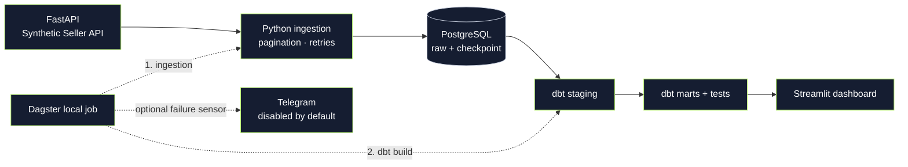

<div align="center">
  
  <h1>Marketplace Intelligence Platform</h1>
  <p><strong>A reliable data platform for marketplace operations.</strong></p>
  <p>Локальная аналитическая платформа на синтетических данных fashion e-commerce.</p>
  <p><a href="#quickstart">Quickstart</a> · <a href="#architecture">Architecture</a> · <a href="#demo">Demo</a> · <a href="#documentation">Documentation</a></p>
  <p>
    <a href="https://github.com/jezannn16/marketplace-data-platform/actions/workflows/ci.yaml"></a>
    
    
    
  </p>
</div>

## Зачем это нужно

Операционные данные маркетплейса поступают отдельно: заказы, товары, остатки и рекламные расходы сложно сопоставлять вручную. Этот проект демонстрирует путь от API до витрин и dashboard, где можно исследовать продажи и состояние запасов. Это **учебная локальная платформа**, а не подключение к реальному маркетплейсу; данные полностью синтетические.

## Features

**Реализовано**

- FastAPI Seller API: детерминированные данные, пагинация, фильтр `updated_at` и сценарии ошибок.
- Python ingestion: повторные попытки, включительный checkpoint, транзакционная запись страниц и upsert по ID в PostgreSQL.
- dbt staging и четыре витрины: продажи по дням, показатели товаров, реклама и риск остатков; тесты качества и инвариантов.
- Dagster job: ingestion → dbt build; локальная история запусков и необязательные Telegram-уведомления об ошибках.
- Streamlit dashboard: графики, фильтры и пояснения показателей; диагностика свежести загрузки.
- Docker Compose, pytest, Ruff и GitHub Actions с PostgreSQL и smoke-проверкой Compose.

**В работе:** см. открытые задачи репозитория, если они созданы. Статус конкретной задачи определяется её описанием, не этим README.

**Возможное развитие:** реальные коннекторы, обработка поздних событий и удалений, атрибуция рекламы и данные возвратов, production-наблюдаемость. Эти возможности не реализованы.

## Architecture



Данные и checkpoint находятся в PostgreSQL. Dagster последовательно запускает загрузку и `dbt build`. Архитектурные решения и границы гарантий описаны в [architecture.md](docs/architecture.md).

## Quickstart

Нужен Docker Desktop или Docker Engine с Compose. Команды выполняются в корне репозитория. В Windows нужны Linux-контейнеры.

macOS/Linux:

```sh
cp .env.example .env
# Укажите собственный POSTGRES_PASSWORD в .env.
docker compose up --build -d --wait
curl http://localhost:8000/health
```

Windows PowerShell:

```powershell
Copy-Item .env.example .env
# Укажите собственный POSTGRES_PASSWORD в .env.
docker compose up --build -d --wait
Invoke-RestMethod http://localhost:8000/health
```

1. Откройте [Dagster](http://localhost:3000) и запустите `marketplace_job`: он загрузит данные и построит dbt-модели.
2. После успешного job откройте [dashboard](http://localhost:8501). До построения моделей он не сможет показать показатели.
3. Контракты API доступны в [OpenAPI](http://localhost:8000/docs).

Для остановки: `docker compose down`. Именованные тома сохраняются; `docker compose down -v` удаляет их. Если изменить пароль в `.env` после первого запуска, пароль в существующем томе PostgreSQL сам не изменится. Локальный запуск macOS без Docker и backup/restore описаны в [local-operations.md](docs/local-operations.md).

## Demo

```sh
curl 'http://localhost:8000/api/v1/orders?page=1&page_size=2'
curl -i 'http://localhost:8000/api/v1/orders?scenario=429'
```

В PowerShell используйте `curl.exe`. Первый запрос возвращает страницу заказов и `next_page`; второй — HTTP 429 с `Retry-After`. После выполнения `marketplace_job` dashboard позволяет посмотреть динамику заказов, рекламу и остатки. [Пошаговый сценарий](docs/demo.md) включает повторный запуск и проверку checkpoint.

## Data quality & reliability

На статичном наборе симулятора сортировка `(updated_at, id)` и включительная граница позволяют повторно читать записи с одинаковым timestamp. Страницы сохраняются транзакционно; checkpoint продвигается при успешной записи последней страницы. Upsert делает повторное чтение идемпотентным. Для HTTP 429, 5xx и временных ошибок транспорта применяются ограниченные повторы с backoff и jitter.

PostgreSQL integration tests покрывают повторную загрузку, сбои страниц и rollback checkpoint; dbt проверяет связи, уникальность и бизнес-инварианты. Это не гарантия для меняющегося offset API: поздние записи ниже checkpoint, удаления и неполные ответы требуют отдельной стратегии. [Сценарии и ограничения](docs/failure-scenarios.md).

## Technology decisions

- **FastAPI** предоставляет воспроизводимый контракт и OpenAPI без реальных клиентских данных.
- **Python, httpx и psycopg** делают транзакции, пагинацию и состояние явными. dlt не используется; его стоит переоценить при расширении числа источников.
- **PostgreSQL и dbt** разделяют сырой слой и проверяемые аналитические модели в одной локальной БД.
- **Dagster и Streamlit** показывают порядок обработки и результаты без отдельной production-инфраструктуры.
- **Docker Compose и uv** фиксируют локальный способ запуска и зависимости; Compose не является защищённым production-развёртыванием.

## Testing

```sh
uv sync --locked
uv run ruff check .
uv run ruff format --check .
uv run pytest
```

Интеграционные тесты пропускаются без `TEST_DATABASE_URL`. **Они удаляют схемы `raw` и `analytics`** в указанной БД: используйте только отдельную тестовую базу с отдельным сегментом `test` в имени. CI создаёт отдельный PostgreSQL и выполняет dbt build и Compose smoke. Инструкции для контрибьюторов — в [CONTRIBUTING.md](CONTRIBUTING.md).

## Configuration

Скопируйте [.env.example](.env.example) в `.env` и задайте локальный пароль; файл `.env` исключён из Git. Параметры портов, схемы dbt, свежести и симуляции ошибок находятся в примере. Telegram отключён по умолчанию; включайте отправку только с разрешения получателя. `DATABASE_URL` нужен CLI в окружении процесса; специальные символы пароля в URL нужно кодировать. Подробности — в [local-operations.md](docs/local-operations.md).

## Project structure

```text
src/api/          синтетический Seller API
src/ingestion/    загрузка и checkpoint
src/operations/   Dagster и уведомления
src/dashboard/    Streamlit и SQL-запросы
dbt/              staging, marts и dbt tests
tests/            unit и PostgreSQL integration tests
docs/             архитектура, demo и сценарии сбоев
assets/brand/     векторный знак и social preview
```

## Roadmap

Предложения для дальнейшей работы: согласованный контракт реального источника и snapshot/keyset-пагинация; правила для возвратов и рекламной атрибуции; плановая оркестрация и внешняя наблюдаемость. Это направления, а не обещание сроков или завершённых функций.

## Limitations

- Локальные сервисы без аутентификации и TLS привязаны к localhost; не публикуйте их в интернет.
- Gross — стоимость всех оформленных заказов, включая отмены, а не признанная выручка. Net revenue и ROAS — `NULL` без возвратов и атрибуции.
- Расходы на рекламу относятся к дате источника, принятой за UTC; заказы и снимки группируются по UTC. Запас в днях — оценка по среднему спросу за 30 дней, а не прогноз.
- Свежесть отражает последнюю успешную загрузку, не SLA и не свежесть исторических данных. Уведомления Telegram — best effort; расписание и production monitoring не настроены.
- Проект не сохраняет историю удалений и не гарантирует отсутствие потерь при изменении реального источника во время offset-пагинации.

## Documentation

[Architecture](docs/architecture.md) · [Demo](docs/demo.md) · [Сценарии сбоев](docs/failure-scenarios.md) · [Локальная эксплуатация](docs/local-operations.md) · [AI-разработка](docs/ai-development.md) · [Вопросы интервью](docs/interview.md) · [Contributing](CONTRIBUTING.md)

## License

Файл лицензии пока не добавлен. Условия повторного использования автору предстоит определить; не предполагается предоставление open-source лицензии.
