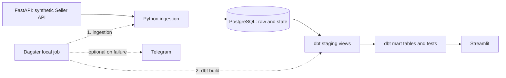

# Архитектура и компромиссы

## Поток и границы компонентов

1. FastAPI генерирует фиксированный синтетический набор и отдаёт страницы с фильтром `updated_at`. Никакой внешний маркетплейс не подключён.
2. Ingestion читает страницы, сохраняет JSONB и checkpoint в PostgreSQL. Он не управляет dbt и не хранит полную историю изменений.
3. dbt читает raw, создаёт staging views и mart tables и выполняет тесты. Заказы, товары, остатки и реклама представлены отдельными моделями.
4. Dagster запускает ingestion до dbt; Streamlit читает витрины и локальную историю Dagster. Необязательный sensor при ошибке может вызвать Telegram. Последний отключён по умолчанию.

## Решения

- **Симулятор** воспроизводим и позволяет проверить ошибки, но не воспроизводит полный контракт настоящего маркетплейса: источники могут добавлять, менять и удалять данные во время запроса.
- **Python/httpx/psycopg вместо dlt**: небольшое число ресурсов и необходимость наглядно проверить checkpoint и транзакцию. Минусы — собственный код пагинации, retries и state, отсутствие готовой нормализации и коннекторов. dlt следует переоценить при расширении числа источников.
- **PostgreSQL** хранит текущую версию raw-записи в JSONB, ID и timestamp; primary key и upsert обеспечивают отсутствие дубликатов. История изменений и удалений не сохраняется. Использование одной БД и superuser-пользователя Compose упрощает локальный запуск, но не подходит для production.
- **Checkpoint** продвигается в транзакции последней страницы. Ранее успешно сохранённые страницы после сбоя читаются повторно. Включительный `updated_at` не теряет соседние ID на одинаковой границе. Обход предполагает неизменный отсортированный набор: нет snapshot, CDC, обработки deletions, полноценной защиты от поздних событий и изменений offset-страниц. Эти ограничения исключают перенос в production без доработки источника и модели state.
- **dbt** отделяет staging от витрин и проверяет контракты. Материализация staging — view, marts — table. Вместо неподтверждённых бизнес-определений фактические net revenue и ROAS оставлены `NULL`. Последние снимки разных складов могут иметь разные даты: общий остаток остаётся видимым с датами, но coverage при их несовпадении не рассчитывается.
- **Dagster** даёт job, граф зависимостей и локальную историю; `dagster dev` с SQLite — инструмент разработки, не отказоустойчивый сервер. Расписания не настроены. **Streamlit** читает модели и локальную историю. Период влияет на продажи/рекламу, не на последние снимки остатков.
- **Docker Compose** поднимает компоненты с named volumes, healthchecks PostgreSQL/API и локальными портами. Приложение работает без root и Linux capabilities; PostgreSQL использует стандартный образ. Это не sandbox и не безопасная публичная deployment-конфигурация. Образы с плавающими тегами, общий образ приложения и superuser БД — сознательные ограничения демо.

## Состояние и эксплуатация

`raw.ingestion_state.completed_at` показывает последнюю успешную обработку ресурса, `cursor_updated_at` — границу исходных данных. Dashboard сравнивает первое значение с порогом `FRESHNESS_MAX_HOURS`; это не полноценный контроль данных, расписания, SLA или доступности источника. Состояние отдельных ресурсов может обновиться до отказа другого ресурса; завершение всего job видно отдельно в Dagster. Freshness чтения не доказывает свежесть исторического содержимого.

Sensor находит неуспешные `marketplace_job`. Telegram выключен по умолчанию; при включении доставка best effort без повторов или гарантий, ошибки отправки не маскируют исходную ошибку job. Секреты задаются через `.env`/окружение и не должны попадать в Git. Проброс переменных в контейнер не заменяет secret manager; на доверенном локальном хосте Docker-операторы могут видеть переменные контейнера.

`postgres_data` содержит данные и checkpoint; `dagster_data` — историю локальных запусков. Резервное копирование БД и проверка восстановления описаны в README; dump не включает роли и том Dagster. Не заявлены регулярные backup, RPO/RTO или проверенное аварийное восстановление.

## Проверка и ограничения безопасности

Параметры значений SQL передаются через psycopg, динамические идентификаторы экранируются `sql.Identifier`, имена raw-таблиц выбираются из фиксированного списка. Выполнен обзор кода и тесты, не полноценный pentest или автоматический аудит CVE. Локальные порты ограничены loopback, но доступ внутри Docker-сети и доступ к UI не авторизованы. В production нужны TLS, отдельные роли, secret manager, контроль доступа, network policies, dependency scanning и наблюдаемость.
